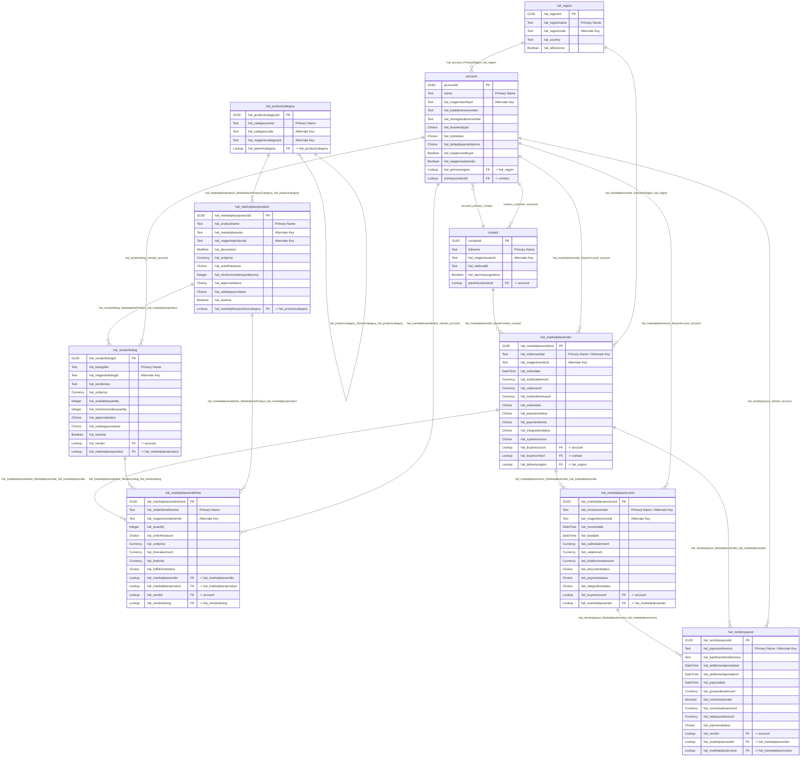

# 01 — Entity Relationship Diagram (`HALCoreDataModel`)

## 1. Metadata & Governance Summary
- **Solution Unique Name:** `HALCoreDataModel`
- **Publisher Prefix:** `hal_`
- **Version:** `1.0.0.0`
- **Domain Scope:** B2B Multi-Vendor Marketplace Operations (Adobe Commerce / Magento 2 ↔ Microsoft Dataverse / Dynamics 365 ↔ ERP / Accounting)
- **Ownership Strategy:**
  - **Organization-Owned (Reference / Master Catalog):** `hal_region`, `hal_productcategory`, `hal_marketplaceproduct`
  - **User or Team-Owned (Core CRM & Transactional Ledgers):** `account`, `contact`, `hal_vendorlisting`, `hal_marketplaceorder`, `hal_marketplaceorderline`, `hal_marketplaceinvoice`, `hal_vendorpayout`

---

## 2. Mermaid.js Entity Relationship Diagram

---

## 3. Data Dictionary & Table Specifications

### 3.1 `Primary Region` (`hal_region`)
- **Ownership:** Organization | **Auditing:** Enabled
- **Primary Key:** `hal_regionid` (GUID) | **Primary Name:** `hal_regionname` (Text)
- **Columns:**
  - `hal_regioncode` (Text) — Unique ISO/Emirate region code (e.g., `AE-DXB`, `AE-AUH`)
  - `hal_country` (Text) — Country name or ISO code
  - `hal_isfreezone` (Yes/No) — Indicates designated Free Zone tax/customs treatment

### 3.2 `Product Category` (`hal_productcategory`)
- **Ownership:** Organization | **Auditing:** Enabled
- **Primary Key:** `hal_productcategoryid` (GUID) | **Primary Name:** `hal_categoryname` (Text)
- **Columns:**
  - `hal_categorycode` (Text) — Internal taxonomy code
  - `hal_magentocategoryid` (Text) — External Adobe Commerce category identifier
  - `hal_parentcategory` (Lookup → `hal_productcategory`) — Self-referential parent hierarchy node

### 3.3 `Account` (`account`)
- **Ownership:** User or Team | **Auditing:** Enabled
- **Primary Key:** `accountid` (GUID) | **Primary Name:** `name` (Text)
- **Custom Marketplace Columns:**
  - `hal_magentoentityid` (Text) — External Adobe Commerce company/seller ID
  - `hal_tradelicensenumber` (Text) — Commercial trade license registration number
  - `hal_taxregistrationnumber` (Text) — UAE TRN / GCC VAT registration number
  - `hal_businesstype` (Choice) — Buyer, Vendor, Dual (Buyer & Vendor), Logistics Partner
  - `hal_kybstatus` (Choice) — Pending Review, Verified, Rejected, Suspended
  - `hal_defaultpaymentterms` (Choice) — Prepaid, Net 15, Net 30, Net 45, Net 60
  - `hal_isapprovedbuyer` (Yes/No) — Enables B2B purchasing eligibility
  - `hal_isapprovedvendor` (Yes/No) — Enables storefront listing & payout eligibility
  - `hal_primaryregion` (Lookup → `hal_region`) — Primary legal/operational jurisdiction

### 3.4 `Contact` (`contact`)
- **Ownership:** User or Team | **Auditing:** Enabled
- **Primary Key:** `contactid` (GUID) | **Primary Name:** `fullname` (Text)
- **Custom Marketplace Columns:**
  - `hal_magentouserid` (Text) — External Adobe Commerce customer user ID
  - `hal_nationalid` (Text) — Emirates ID / National ID for KYB verification
  - `hal_isprimarysignatory` (Yes/No) — Authorized legal signatory flag

### 3.5 `Marketplace Product` (`hal_marketplaceproduct`)
- **Ownership:** Organization | **Auditing:** Enabled
- **Primary Key:** `hal_marketplaceproductid` (GUID) | **Primary Name:** `hal_productname` (Text)
- **Columns:**
  - `hal_marketplacesku` (Text) — Canonical master catalog SKU
  - `hal_magentoproductid` (Text) — External Adobe Commerce master product ID
  - `hal_description` (Multiline Text) — Rich technical specification
  - `hal_unitprice` (Currency) — Reference list price
  - `hal_unitofmeasure` (Choice) — Piece, Box, Carton, Kg, Ton, Liter, Meter, Pallet
  - `hal_minimumorderquantitymoq` (Whole Number) — Global baseline MOQ
  - `hal_approvalstatus` (Choice) — Draft, Pending Approval, Approved, Rejected
  - `hal_catalogsyncstatus` (Choice) — Pending Sync, Synced, Sync Failed, Out of Sync
  - `hal_isactive` (Yes/No) — Master catalog active state
  - `hal_marketplaceproductcategory` (Lookup → `hal_productcategory`) — Category classification

### 3.6 `Vendor Listing` (`hal_vendorlisting`)
- **Ownership:** User or Team | **Auditing:** Enabled
- **Primary Key:** `hal_vendorlistingid` (GUID) | **Primary Name:** `hal_listingtitle` (Text)
- **Columns:**
  - `hal_magentolistingid` (Text) — External Adobe Commerce vendor offer ID
  - `hal_vendorsku` (Text) — Vendor's internal ERP/warehouse SKU
  - `hal_unitprice` (Currency) — Vendor-specific commercial unit price
  - `hal_availablequantity` (Whole Number) — Current sellable stock quantity
  - `hal_minimumorderquantity` (Whole Number) — Vendor-specific MOQ override
  - `hal_approvalstatus` (Choice) — Draft, Pending Approval, Approved, Rejected
  - `hal_catalogsyncstatus` (Choice) — Pending Sync, Synced, Sync Failed, Out of Sync
  - `hal_isactive` (Yes/No) — Offer availability flag
  - `hal_vendor` (Lookup → `account`) — Selling vendor account
  - `hal_marketplaceproduct` (Lookup → `hal_marketplaceproduct`) — Parent master product

### 3.7 `Marketplace Order` (`hal_marketplaceorder`)
- **Ownership:** User or Team | **Auditing:** Enabled
- **Primary Key:** `hal_marketplaceorderid` (GUID) | **Primary Name:** `hal_ordernumber` (Text)
- **Columns:**
  - `hal_magentoorderid` (Text) — External Adobe Commerce order increment/entity ID
  - `hal_orderdate` (Date/Time) — Timestamp of order placement
  - `hal_subtotalamount` (Currency) — Pre-tax merchandise total
  - `hal_vatamount` (Currency) — Calculated VAT total
  - `hal_totalorderamount` (Currency) — Grand total inclusive of VAT
  - `hal_orderstate` (Choice) — New, Pending Payment, Processing, Partially Fulfilled, Fulfilled, Completed, Cancelled, On Hold
  - `hal_paymentstatus` (Choice) — Unpaid, Authorized, Partially Paid, Paid, Refunded, Failed
  - `hal_paymentterms` (Choice) — Prepaid, Net 15, Net 30, Net 45, Net 60
  - `hal_integrationstatus` (Choice) — Not Required, Pending, In Progress, Synced, Error
  - `hal_systemsource` (Choice) — Adobe Commerce, Dynamics 365 Sales, Manual Entry, EDI / API
  - `hal_buyeraccount` (Lookup → `account`) — Purchasing B2B organization
  - `hal_buyercontact` (Lookup → `contact`) — Ordering buyer contact
  - `hal_deliveryregion` (Lookup → `hal_region`) — Destination region/emirate

### 3.8 `Marketplace Order Line` (`hal_marketplaceorderline`)
- **Ownership:** User or Team | **Auditing:** Enabled
- **Primary Key:** `hal_marketplaceorderlineid` (GUID) | **Primary Name:** `hal_orderlinereference` (Text)
- **Columns:**
  - `hal_magentoorderitemid` (Text) — External Adobe Commerce `item_id`
  - `hal_quantity` (Whole Number) — Ordered unit quantity
  - `hal_unitofmeasure` (Choice) — Unit of measure at time of order
  - `hal_unitprice` (Currency) — Unit price locked at order capture
  - `hal_linevatamount` (Currency) — Line-level VAT amount
  - `hal_linetotal` (Currency) — Line total inclusive of VAT
  - `hal_fulfillmentstatus` (Choice) — Unfulfilled, Allocated, Picked, Shipped, Delivered, Cancelled, Returned
  - `hal_marketplaceorder` (Lookup → `hal_marketplaceorder`) — Parent order header
  - `hal_marketplaceproduct` (Lookup → `hal_marketplaceproduct`) — Ordered master product
  - `hal_vendor` (Lookup → `account`) — Fulfilling vendor account
  - `hal_vendorlisting` (Lookup → `hal_vendorlisting`) — Specific vendor offer purchased

### 3.9 `Marketplace Invoice` (`hal_marketplaceinvoice`)
- **Ownership:** User or Team | **Auditing:** Enabled
- **Primary Key:** `hal_marketplaceinvoiceid` (GUID) | **Primary Name:** `hal_invoicenumber` (Text)
- **Columns:**
  - `hal_magentoinvoiceid` (Text) — External Adobe Commerce invoice ID
  - `hal_invoicedate` (Date/Time) — Official tax invoice issue date
  - `hal_duedate` (Date/Time) — Payment due date computed from `hal_paymentterms`
  - `hal_subtotalamount` (Currency) — Pre-tax invoiced subtotal
  - `hal_vatamount` (Currency) — Total VAT charged
  - `hal_totalinvoiceamount` (Currency) — Gross receivable amount
  - `hal_documentstatus` (Choice) — Draft, Issued, Sent, Voided, Credit Memo Issued
  - `hal_paymentstatus` (Choice) — Unpaid, Partially Paid, Paid, Overdue, Written Off
  - `hal_integrationstatus` (Choice) — Not Required, Pending, In Progress, Synced, Error
  - `hal_buyeraccount` (Lookup → `account`) — Billed buyer organization
  - `hal_marketplaceorder` (Lookup → `hal_marketplaceorder`) — Source marketplace order

### 3.10 `Vendor Payout` (`hal_vendorpayout`)
- **Ownership:** User or Team | **Auditing:** Enabled
- **Primary Key:** `hal_vendorpayoutid` (GUID) | **Primary Name:** `hal_payoutreference` (Text)
- **Columns:**
  - `hal_banktransferreference` (Text) — Bank wire / WPS / IBAN settlement trace ID
  - `hal_settlementperiodstart` (Date/Time) — Settlement window start
  - `hal_settlementperiodend` (Date/Time) — Settlement window end
  - `hal_payoutdate` (Date/Time) — Actual disbursement timestamp
  - `hal_grosssalesamount` (Currency) — Total vendor sales eligible for payout
  - `hal_commissionrate` (Decimal) — Platform take-rate percentage
  - `hal_commissionamount` (Currency) — Platform commission retained
  - `hal_netpayoutamount` (Currency) — Net funds remitted to vendor ($\text{Gross} - \text{Commission}$)
  - `hal_paymentstatus` (Choice) — Pending Calculation, Approved for Payout, Processing, Paid, Failed, On Hold
  - `hal_vendor` (Lookup → `account`) — Beneficiary vendor account
  - `hal_marketplaceorder` (Lookup → `hal_marketplaceorder`) — Associated order reference
  - `hal_marketplaceinvoice` (Lookup → `hal_marketplaceinvoice`) — Associated settled buyer invoice

---

## 4. Relationship Registry & Cascade Governance

| Relationship Schema Name | Parent (`1`) | Child (`N`) | Lookup Column | Delete Behavior |
|---|---|---|---|---|
| `hal_account_PrimaryRegion_hal_region` | `hal_region` | `account` | `hal_primaryregion` | Restrict |
| `hal_marketplaceorder_DeliveryRegion_hal_region` | `hal_region` | `hal_marketplaceorder` | `hal_deliveryregion` | Restrict |
| `hal_productcategory_ParentCategory_hal_productcategory` | `hal_productcategory` | `hal_productcategory` | `hal_parentcategory` | Remove Link |
| `hal_marketplaceproduct_MarketplaceProductCategory_hal_productcategory` | `hal_productcategory` | `hal_marketplaceproduct` | `hal_marketplaceproductcategory` | Restrict |
| `hal_vendorlisting_MarketplaceProduct_hal_marketplaceproduct` | `hal_marketplaceproduct` | `hal_vendorlisting` | `hal_marketplaceproduct` | Restrict |
| `hal_marketplaceorderline_MarketplaceProduct_hal_marketplaceproduct` | `hal_marketplaceproduct` | `hal_marketplaceorderline` | `hal_marketplaceproduct` | Restrict |
| `hal_vendorlisting_Vendor_account` | `account` | `hal_vendorlisting` | `hal_vendor` | Restrict |
| `hal_marketplaceorder_BuyerAccount_account` | `account` | `hal_marketplaceorder` | `hal_buyeraccount` | Restrict |
| `hal_marketplaceorder_BuyerContact_contact` | `contact` | `hal_marketplaceorder` | `hal_buyercontact` | Remove Link |
| `hal_marketplaceorderline_Vendor_account` | `account` | `hal_marketplaceorderline` | `hal_vendor` | Restrict |
| `hal_marketplaceorderline_VendorListing_hal_vendorlisting` | `hal_vendorlisting` | `hal_marketplaceorderline` | `hal_vendorlisting` | Restrict |
| `hal_marketplaceorderline_MarketplaceOrder_hal_marketplaceorder` | `hal_marketplaceorder` | `hal_marketplaceorderline` | `hal_marketplaceorder` | Parental / Cascade |
| `hal_marketplaceinvoice_BuyerAccount_account` | `account` | `hal_marketplaceinvoice` | `hal_buyeraccount` | Restrict |
| `hal_marketplaceinvoice_MarketplaceOrder_hal_marketplaceorder` | `hal_marketplaceorder` | `hal_marketplaceinvoice` | `hal_marketplaceorder` | Restrict |
| `hal_vendorpayout_Vendor_account` | `account` | `hal_vendorpayout` | `hal_vendor` | Restrict |
| `hal_vendorpayout_MarketplaceOrder_hal_marketplaceorder` | `hal_marketplaceorder` | `hal_vendorpayout` | `hal_marketplaceorder` | Restrict |
| `hal_vendorpayout_MarketplaceInvoice_hal_marketplaceinvoice` | `hal_marketplaceinvoice` | `hal_vendorpayout` | `hal_marketplaceinvoice` | Restrict |