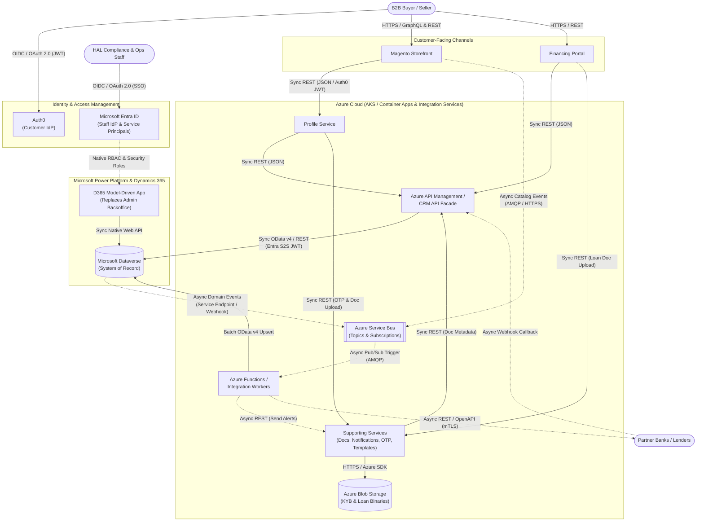

# System Integration Architecture

## 1. End-to-End Integration Topology

The diagram below illustrates how HAL's customer-facing channels, Azure microservices, identity providers, external lending partners, and Microsoft Dataverse communicate using a **hybrid synchronous (REST/OData) and asynchronous event-driven (Azure Service Bus)** architecture.

* **Solid arrows (`-->`)** represent **Synchronous** request/response calls.
* **Dashed arrows (`-.->`)** represent **Asynchronous / Event-Driven** flows (Pub/Sub topics, webhooks, and background workers).

