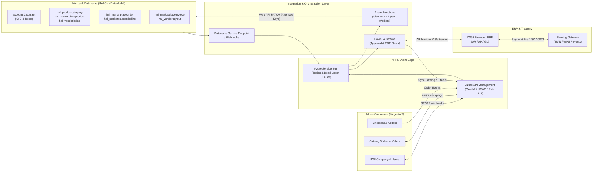

# 02 — System Integration Architecture

## 1. Architectural Vision & Topology
The **HAL Marketplace Platform** uses **Microsoft Dataverse (`HALCoreDataModel`)** as the **Operational System of Record (SoR)** for B2B account governance, KYB compliance, catalog approval, multi-vendor order splitting, invoicing, and vendor payout settlement.

- **Digital Storefront & Checkout Layer:** Adobe Commerce (Magento 2) handles B2B buyer authentication, storefront browsing, cart assembly, and checkout capture.
- **Core Operational Hub:** Microsoft Dataverse (`HALCoreDataModel`) + Dynamics 365 Customer Engagement apps govern master data, approvals, order orchestration, and settlement calculations.
- **Enterprise Integration Backbone:** Azure Integration Services (**Azure Service Bus**, **Azure API Management (APIM)**, **Azure Functions**, and **Power Automate**) decouple real-time storefront actions from back-office ERP processing.
- **Financial & General Ledger ERP:** Dynamics 365 Finance / ERP executes AR invoice posting, bank reconciliation, and AP vendor bank disbursements.

---

## 2. End-to-End Integration Topology Diagram

---

## 3. Core Integration Flows & System-of-Record Boundaries

### 3.1 Master Data Ownership Matrix

| Domain Object | Authoritative System of Record | Secondary Replica(s) | Synchronization Pattern |
|---|---|---|---|
| **Regions & Tax Zones** (`hal_region`) | Dataverse (`HALCoreDataModel`) | Adobe Commerce, ERP | Reference push on change |
| **Product Categories** (`hal_productcategory`) | Dataverse (`HALCoreDataModel`) | Adobe Commerce | Event-driven outbound sync |
| **B2B Buyer / Vendor Accounts** (`account`, `contact`) | Dataverse (`HALCoreDataModel`) | Adobe Commerce, ERP | Bidirectional (Registration from M2; KYB/Approval from Dataverse) |
| **Master Products** (`hal_marketplaceproduct`) | Dataverse (`HALCoreDataModel`) | Adobe Commerce | Outbound push upon `hal_approvalstatus = Approved` |
| **Vendor Listings & Inventory** (`hal_vendorlisting`) | Hybrid (Vendor Portal / M2 for stock; Dataverse for approval) | Adobe Commerce | Bidirectional (Stock/Price inbound; Approval outbound) |
| **Marketplace Orders & Lines** (`hal_marketplaceorder`, `hal_marketplaceorderline`) | Adobe Commerce (Capture) → Dataverse (Fulfillment & Splitting) | ERP | Inbound order ingestion; outbound fulfillment updates |
| **Tax Invoices** (`hal_marketplaceinvoice`) | Dataverse / ERP Finance | Adobe Commerce (Buyer Portal) | Outbound to ERP for GL posting; PDF/status sync to M2 |
| **Vendor Payouts** (`hal_vendorpayout`) | Dataverse (Calculation) → ERP (Disbursement) | Vendor Portal | Scheduled settlement batch + ERP payment confirmation |

---

## 4. Resilience, Idempotency & Error Handling Patterns

1. **Alternate Key Upserts (`PATCH`):**
   - Every inbound integration worker resolves Dataverse records using published **Alternate Keys** (`hal_magentoentityid`, `hal_magentouserid`, `hal_magentocategoryid`, `hal_marketplacesku`, `hal_magentolistingid`, `hal_magentoorderid`, `hal_magentoorderitemid`, `hal_magentoinvoiceid`) rather than querying GUIDs first.
   - This guarantees atomic idempotency across retries and out-of-order message delivery.
2. **State Tracking via `hal_integrationstatus` & `hal_catalogsyncstatus`:**
   - Transactional records (`hal_marketplaceorder`, `hal_marketplaceinvoice`) track outbound ERP/storefront sync health via `hal_integrationstatus` (`Pending`, `In Progress`, `Synced`, `Error`).
   - Catalog records (`hal_marketplaceproduct`, `hal_vendorlisting`) track storefront publishing via `hal_catalogsyncstatus` (`Pending Sync`, `Synced`, `Sync Failed`, `Out of Sync`).
3. **Dead-Letter Queue (DLQ) & Replay:**
   - Azure Service Bus topics enforce exponential backoff (5 retries) before routing poisoned payloads to a Dead-Letter Queue, triggering an alert to Operations with correlation IDs (`hal_magentoorderid` / `hal_ordernumber`).
4. **Multi-Vendor Order Splitting:**
   - A single checkout in Adobe Commerce produces one `hal_marketplaceorder` header (`hal_buyeraccount`, `hal_buyercontact`, `hal_deliveryregion`) and $N$ `hal_marketplaceorderline` rows, where each line explicitly binds to its fulfilling `hal_vendor` (`account`) and `hal_vendorlisting`.
   - This allows independent line-level `hal_fulfillmentstatus` tracking and per-vendor `hal_vendorpayout` settlement without splitting the buyer's checkout experience.